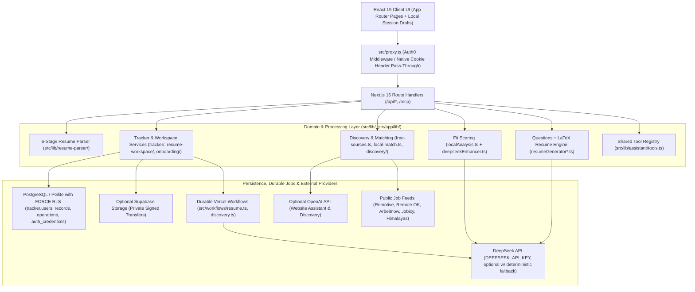
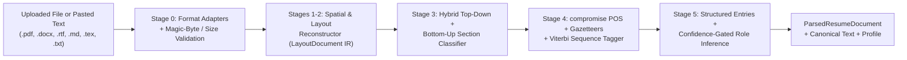

# VibeCheck System Architecture

VibeCheck is a full-stack career workspace and resume intelligence platform built on Next.js 16 (App Router), React 19, TypeScript, Tailwind CSS, PostgreSQL Row-Level Security (via `pg` or embedded `@electric-sql/pglite`), Vercel `workflow` durable execution, and DeepSeek AI. It combines a fast, public-ready **4-step resume tailoring and Keep-Current-Resume studio** with a private, multi-tenant **Job Application Portal**.

---

## 1. Product Surfaces & Core User Journeys

Every core workflow shares the same validation, parsing, analysis, and immutable versioning services:

| Route / Surface | Purpose | Key UI / API Modules |
| :--- | :--- | :--- |
| `/` (`OnboardingFlow`) | Guided entry: upload or build a resume, choose **Keep my current resume** (untouched original) or **Tailor to a job description** (`Upload -> Fit Report -> Targeted Resume Builder -> Preview`), then optionally create an account to open the full portal. | [OnboardingFlow.tsx](file:///c:/Users/dunca/Desktop/the%20dump/vibecheckresume/src/components/onboarding/OnboardingFlow.tsx), `/api/onboarding`, `/api/resumes/session` |
| `/analyze` (`SessionResumeStudio`) | Public/authenticated 4-step studio (`1. Upload & JD -> 2. Fit Report -> 3. Resume Builder -> 4. Preview / Keep Current`) with browser draft persistence and one-click Save to Job Tracker (`save_session_bundle`). | [SessionResumeStudio.tsx](file:///c:/Users/dunca/Desktop/the%20dump/vibecheckresume/src/components/resume-workspace/SessionResumeStudio.tsx), `/api/resumes/session`, `/api/resumes` |
| `/dashboard` | Workspace overview: pipeline stage counts, upcoming tasks/interviews, recent applications, and quick-start onboarding/analysis actions. | [Dashboard.tsx](file:///c:/Users/dunca/Desktop/the%20dump/vibecheckresume/src/components/tracker/Dashboard.tsx) |
| `/applications` & `/applications/[id]` | Searchable Kanban board and table across fixed hiring stages (`Saved` through `Withdrawn`), plus per-application notes, contacts, follow-up tasks, interviews, fit analyses, and versioned resume workspace. | [Applications.tsx](file:///c:/Users/dunca/Desktop/the%20dump/vibecheckresume/src/components/tracker/Applications.tsx), [ApplicationResumes.tsx](file:///c:/Users/dunca/Desktop/the%20dump/vibecheckresume/src/components/resume-workspace/ApplicationResumes.tsx) |
| `/resumes` | Private Resume Library (`source_resume` originals + starter previews) paired with `SessionResumeStudio`. | [Resumes.tsx](file:///c:/Users/dunca/Desktop/the%20dump/vibecheckresume/src/components/tracker/Resumes.tsx), [ResumeLibrary.tsx](file:///c:/Users/dunca/Desktop/the%20dump/vibecheckresume/src/components/resume-workspace/ResumeLibrary.tsx) |
| `/discover` | Live keyless public job board aggregation ranked against the user's preferences and resume fit, plus optional server discovery runs. | [LocalDiscovery.tsx](file:///c:/Users/dunca/Desktop/the%20dump/vibecheckresume/src/components/discovery/LocalDiscovery.tsx), [DiscoveryPage.tsx](file:///c:/Users/dunca/Desktop/the%20dump/vibecheckresume/src/components/discovery/DiscoveryPage.tsx), `/api/jobs/search` |
| `/tasks` | Follow-up task and interview queue across active applications with timezone preservation. | [Tasks.tsx](file:///c:/Users/dunca/Desktop/the%20dump/vibecheckresume/src/components/tracker/Tasks.tsx) |
| `/assistant` | Embedded workspace AI assistant wired to shared validated tracker tools. | [Assistant.tsx](file:///c:/Users/dunca/Desktop/the%20dump/vibecheckresume/src/components/tracker/Assistant.tsx), `/api/assistant` |
| `/settings` | Account readiness diagnostics, profile/preference links, and ChatGPT MCP connection management. | [Settings.tsx](file:///c:/Users/dunca/Desktop/the%20dump/vibecheckresume/src/components/tracker/Settings.tsx), `/api/tracker/connection` |
| `/signin`, `/onboarding`, `/verify-email` | Native email/password login/signup, Auth0 OIDC callback/verification gating, and preference editing. | [WorkspaceAccess.tsx](file:///c:/Users/dunca/Desktop/the%20dump/vibecheckresume/src/components/auth/WorkspaceAccess.tsx), `/api/auth/*` |

Legacy routes (`/result`, `/resume-builder`, `/resume-preview`) redirect explicitly into `/resumes?import=1`, while retired anonymous routes (`/api/analyze`, `/api/generate-resume`) return HTTP `410` in favor of `/api/resumes/session` and `/api/resumes`.

---

## 2. System Topology & Layered Architecture



### Runtime Separation Rules
- **Next.js `16.3.5` Request Boundary (`src/proxy.ts`)**: Propagates `x-vibecheck-path` for server components, handles Auth0 OIDC middleware when configured, and clears native `vc_session` cookies on `/auth/logout` without blocking public onboarding or `/analyze`.
- **Client vs. Node Server Bundles (`next.config.js`)**:
  - `serverExternalPackages`: `['pg', 'pdfjs-dist', '@electric-sql/pglite', 'mammoth']` keeps heavy binary/native/database drivers strictly out of client bundles.
  - `transpilePackages`: `['compromise', 'efrt', 'suffix-thumb']` enables the local NLP engine to execute in both browser text/paste parsing (`@/lib/resume-parser`) and Node API routes (`@/lib/resume-parser/server`).
  - `outputFileTracingIncludes`: bundles `pdf.worker.mjs` for `/api/resumes`, `/api/resumes/session`, and `/api/resumes/upload`.

---

## 3. Authentication, Authorization & Multi-Tenant Security

### Dual Authentication Providers (`src/lib/tracker/auth.ts`, `native-auth.ts`, `config.ts`)
VibeCheck supports two authentication modes that converge on a single UUID `User.id`:
1. **First-Party PostgreSQL Accounts (`/api/auth/signup`, `/api/auth/login`, `/api/auth/logout`)**:
   - Credentials stored in `tracker.auth_credentials` (`0003_auth_credentials.sql`) using salted Node `crypto.scrypt` hashes (`scrypt:<salt>:<64-byte-hex>`) verified with constant-time `timingSafeEqual`.
   - Deterministically maps email to UUID via `nativeUserId(email)` (SHA-256 `vibecheck:local\0<email>`).
   - Issues an `HttpOnly`, `SameSite=Lax` HMAC-SHA256 signed session cookie (`vc_session`, 30-day TTL) signed with `AUTH_SECRET` (or fallback `AUTH0_SECRET`).
   - Enforces per-IP auth rate limiting (`25` requests/minute outside `NODE_ENV === 'test'`).
2. **Optional Auth0 OIDC (`getAuth0()`, `@auth0/nextjs-auth0`)**:
   - Activated when `AUTH0_DOMAIN`, `AUTH0_CLIENT_ID`, `AUTH0_CLIENT_SECRET`, `AUTH0_SECRET`, and `APP_BASE_URL` are configured.
   - Maps `(issuer, subject)` to UUID via `identityId(issuer, subject)` and requires verified email (`assertEmailVerified`).
   - Used for ChatGPT MCP OAuth bearer tokens (`requireMcpUser`), verifying RS256 signatures via remote JWKS, audience (`MCP_AUDIENCE`), required scopes, and per-user revocation timestamps (`connection.revokedBefore`).

### PostgreSQL Row-Level Security & Concurrency Guarantees
- **Owner-Scoped Transactions (`withOwnerTransaction(ownerId, fn)` in `src/lib/tracker/db.ts`)**:
  Every database read/write opens a transaction and executes `SELECT set_config('app.user_id', $1, true)` before issuing any SQL.
- **Forced RLS Policies (`drizzle/0000_tracker.sql` – `0003_auth_credentials.sql`)**:
  All 6 tables in the `tracker` schema (`users`, `records`, `operations`, `openai_connections`, `openai_oauth_transactions`, `auth_credentials`) enable `ENABLE ROW LEVEL SECURITY` and `FORCE ROW LEVEL SECURITY`, restricting access to rows matching `NULLIF(current_setting('app.user_id', true), '')::uuid`.
- **Restricted Runtime Role Check (`src/lib/tracker/readiness.ts`)**:
  Production runtime connects as the unprivileged `vibecheck_app` role (`NOSUPERUSER NOBYPASSRLS`). `readiness.ts` actively probes PostgreSQL policies using a restricted-role check to verify RLS cannot be bypassed before marking the instance ready.
- **Optimistic Concurrency & Idempotent Mutations (`src/lib/tracker/store.ts`)**:
  - `updateRecord` requires `expectedVersion` and fails with HTTP `409 CONFLICT` on concurrent edits.
  - `idempotent(ownerId, key, operation, input, callback)` acquires a transaction-scoped advisory lock (`pg_advisory_xact_lock(hashtextextended($1, 0))`) and replays prior identical results while rejecting reused keys with differing payloads (`409`).
- **Session Endpoint Protections (`/api/resumes/session`)**:
  Rejects cross-origin requests (`checkSameOrigin` via `sec-fetch-site`, `origin`, and `host`) and enforces an IP sliding-window rate limit (`25` requests per 15 minutes).

---

## 4. 6-Stage Multi-Format Layout + Local Sequence NLP Resume Parser (`src/lib/resume-parser/`)

Previously, PDF extraction flattened `TextContent.items` linearly with `hasEOL` (losing link annotations and 2-column coordinates), and `extractHeadline()` selected header text by negative exclusion alone. As a result, PDFs with clickable LaTeX links like `\href{...}{GitHub} | \href{...}{LinkedIn} | \href{...}{Portfolio}` rendered `"GitHub | LinkedIn | Portfolio"` as `profile.headline` and prefilled `"Roles you are looking for"` with social link labels.

To solve this deterministically (`< 40ms` per document, zero LLM calls or external latency during upload), `src/lib/resume-parser/` implements a 6-stage layout- and context-aware pipeline:



### Stage 0: Multi-Format Validation & Ingestion (`formats.ts`, `adapters/*`)
`validateUpload()` enforces non-empty files `<= 8 MB`, rejects legacy binary `.doc` with actionable guidance, and validates extension + MIME compatibility across six canonical formats mapped into a shared **`LayoutDocument`** IR (`LayoutLine[]` with `text`, `leftText`, `rightText`, `x`, `y`, `fontSize`, `isBold`, `isItalic`, `isUpperCase`, `hasBullet`, `indent`, `gapAbove`, `column`, `links`, `headingLevel`):

| Format | MIME Type | Extractor & Structural Signals Preserved |
| :--- | :--- | :--- |
| **PDF** (`.pdf`) | `application/pdf` | `adapters/pdf.ts` (`pdfjs-dist` v6): verifies `%PDF-` signature, limits to 100 pages / 250k chars, extracts viewport-normalized `(x, y, width, height)`, font styles (including Computer Modern `CMBX`/`CMTI`), and spatially joins `page.getAnnotations({ intent: 'display' })` link `rect`s (`https:`, `mailto:`, `tel:`) onto spans. |
| **DOCX** (`.docx`) | `application/vnd.openxmlformats-officedocument.wordprocessingml.document` | `adapters/docx.ts` (`mammoth`): verifies ZIP `PK` magic bytes, converts OOXML to HTML, extracts headings (`h1`-`h6`), bold/italic runs, bullet lists (`li`), `<a href>` links, split header/date table rows, and 2-column layout tables. |
| **RTF** (`.rtf`) | `application/rtf` | `adapters/rtf.ts`: verifies `{\rtf` header, parses group stacks (`\fonttbl`/`\colortbl`/`\pict` skipped), `\b`/`\i`/`\fsN`, `\tab` split rows, hex `\'hh` and `\uN` Unicode escapes, and `HYPERLINK` fields. |
| **Markdown** (`.md`, `.markdown`) | `text/markdown` | `adapters/markdown.ts`: extracts `#` headings, emphasis, lists, 2-column Markdown tables, and `[label](url)` links. |
| **LaTeX** (`.tex`, `.latex`) | `application/x-tex` | `adapters/latex.ts`: strips comments/preamble, parses `\section`, `\resumeSubheading{a}{b}{c}{d}`, `\resumeProjectHeading`, `\item`/`\resumeItem`, `\textbf`/`\emph`, `\href{url}{label}`, and `\url{url}`. |
| **Plain Text / Paste** (`.txt`) | `text/plain` | `adapters/text.ts`: preserves blank-line `gapAbove`, indentation, bullets, explicit URLs, and tab/multi-space tabular right columns. |

### Stages 1 & 2: Geometric Layout Reconstruction (`layoutOrder.ts`)
- **Row Clustering & Kerning Repair**: Clusters PDF `TextItem`s by baseline `y` tolerance (`0.38 * fontSize`), sorts left-to-right by `x`, merges kerning splits (`dx <= 0.14 * fontSize`) without bogus spaces, splits wide horizontal jumps (`dx > 2.35 * fontSize`) into separate segments (preserving `leftText` + right-aligned `rightText` dates/locations), and merges consecutive same-`href` anchor fragments.
- **1-Column vs. 2-Column Gutter Detection**: Scans body rows below the top header band (`0.22 * pageHeight`) across candidate `x` gutters (`26%–68%` of page width). If `>= 5` non-date multi-word rows populate both sides with `< 16%` crossing spans, classifies as `two-column` and reorders output `header -> main (wider) -> sidebar (narrower)` so sidebar skills/contact never interleave into Experience bullets.
- **Wrapped Bullet Merging & Canonical Text**: Merges hanging-indent wrapped bullet lines and builds `canonicalText` while surfacing recovered `href` URLs/emails in header lines (`GitHub (https://github.com/...)`) so downstream text consumers retain full link metadata.

### Stage 3: Hybrid Top-Down + Bottom-Up Section Segmentation (`sectionSegmenter.ts`)
- **Top-down**: Matches canonical section vocabulary (including inline colon prefixes like `Skills: Python, SQL`) and typographic heading contrast (`headingLevel`, `fontSize >= 1.15 * median`, uppercase + bold + `gapAbove`), isolating `HeaderZone` (including 2-column `"Contact"` sidebars).
- **Bottom-up**: Custom headings initially tagged `'other'` (e.g. `"Where I've Worked"`, `"Selected Work"`, `"Toolkit"`) are reclassified by aggregating child line NLP signals (dates + action-verb bullets -> `experience`/`projects`; degree phrases -> `education`; delimited skill lists -> `skills`).

### Stage 4: Local POS, Gazetteers & Viterbi Sequence Tagger (`nlp/`)
- **`gazetteers.ts` & `signals.ts`**: Combines **`compromise`** (`#PastTense`, `#Gerund`, `#Person`, `#Organization`, `#Place`) with domain gazetteers:
  - `LINK_ANCHOR_LABELS`: explicitly classifies `"GitHub"`, `"LinkedIn"`, `"Portfolio"`, `"Website"`, `"Scholar"`, `"Dribbble"`, etc. as `link_label` segments so link bars are permanently blocked from `headline`, `location`, `fullName`, and `workHighlights` even without URLs.
  - Cross-industry role lexicon (`ROLE_HEAD_NOUNS`, `ROLE_MODIFIERS`, `ROLE_FRAME_PATTERNS` supporting software, finance, healthcare, legal, operations, academia, trades, `Member of Technical Staff`, `Head of ...`, etc.).
  - Context-scoped URL extraction: extracts explicit URLs anywhere and bare domain names (`name.xyz`) strictly in header/contact zones, preventing technical terms in bullets (`Next.js`, `Knorket.AI`, `unstructured.io`) from polluting `links`.
- **`sequenceTagger.ts`**:
  - **Header sequence tagger**: Labels header rows (`NAME`, `HEADLINE`, `CONTACT_OR_LINK`, `LOCATION`, `META_NOTE`, `PROSE`), disambiguating human names (`"Taylor Morgan"`) from employers (`"Morgan Stanley"`) and gating `HEADLINE` with positive semantic role scoring (`scoreRoleTitle >= 0.65`).
  - **Linear-chain Viterbi body decoder**: Uses log-space emission + transition weights over states `{ ORG_LINE, ROLE_LINE, COMBINED_HEADER, PROJECT_HEADER, BULLET, CONTINUATION }`, naturally handling:
    - Company-above-role (`Company` -> italic `Role | Date` -> bullets, Jake's LaTeX layout)
    - Role-above-company (`Role | Date` -> `Company | Loc` -> bullets)
    - Promotions at one employer (`ORG` -> `Role 1` -> bullets -> `Role 2` -> bullets, inheriting `activeCompany`)
    - Single-word ambiguous orgs (`"Stripe"`, `"Linear"`) paired next to strong `ROLE_LINE` neighbors
    - Glyph-less bullets starting with past-tense action verbs (`"Architected..."`, `"Negotiated..."`).

### Stage 5: Structured Assembly & Confidence-Gated Role Inference (`fieldExtractors.ts`, `roleInference.ts`, `index.ts`)
Emits `ParsedResumeDocument` (`links: TypedLink[]`, `experience: ExperienceEntry[]`, `projects: ProjectEntry[]`, `education: EducationEntry[]`, `skillCategories: SkillCategory[]`, `flatSkills`, `certifications`, `awards`, `suggestedRoles`) alongside backward-compatible adapters `toResumeBuilderProfile()` ([resumeBuilderProfile.ts](file:///c:/Users/dunca/Desktop/the%20dump/vibecheckresume/src/app/lib/resumeBuilderProfile.ts)) and `toPreservedPreviewSections()`.

`inferSuggestedRoles()` populates **"Roles you are looking for"** and prefill fields with strict confidence gating:
1. **Verified Header `headline` (`confidence: 0.90`)**: Normalized positive-gated title + distinct recent Experience titles.
2. **Experience Titles (`confidence: 0.85`)**: Top 1–3 distinct normalized `ExperienceEntry.title` values (stripping `@ Company`, level codes like `(L5)`).
3. **Student / Early-Career Inference (`confidence: 0.68`)**: When no Experience titles exist, maps Education field + Project/Skill clusters into concrete role titles (never raw skill tokens like `"Git, CSS, HTML"`).
4. **Confidence Threshold (`< 0.65`)**: Leaves `"Roles you are looking for"` blank (`source: 'none', confidence: 0`) rather than guessing.

---

## 5. Fit Scoring, Resume Builder & LaTeX Generation Engine

```mermaid
sequenceDiagram
  participant User
  participant UI as Onboarding / Studio / App Workspace
  participant SessionAPI as /api/resumes/session or /api/resumes
  participant Engine as localAnalysis + deepseekEnhancer + resumeGenerator
  participant DB as PostgreSQL RLS Store

  User->>UI: Upload Resume + Target JD (or click Keep Current Resume)
  alt Keep Current Resume
    UI->>DB: Save source_resume untouched; set submittedSourceResumeId
  else Tailor to JD
    UI->>SessionAPI: action = "analyze"
    SessionAPI->>Engine: DeepSeek analyzeWithAI() or buildDeterministicAnalysis()
    Engine-->>UI: Step 2: Detailed Fit Report (score, category breakdown, requirement evidence)
    User->>UI: Answer targeted follow-up questions in Resume Builder
    UI->>SessionAPI: action = "generate" (answers + analysis + sourceText)
    SessionAPI->>Engine: generateTailoredResume() or buildDeterministicGeneration()
    Engine-->>UI: Step 4: GeneratedResume (preview JSON + Jake's ATS LaTeX)
    UI->>DB: Persist immutable resume_version; set submittedResumeVersionId
  end
```

- **Evidence-Backed Fit Scoring (`localAnalysis.ts`, `deepseekEnhancer.ts`)**: Computes weighted category scores (`technical_skills`, `experience_and_impact`, `projects_and_open_source`, `role_alignment`), skill gaps, line-level requirement evidence (`matched` / `partial` / `missing`), and priority rewrite actions. If `DEEPSEEK_API_KEY` is unset or transiently fails, `/api/resumes/session` seamlessly falls back to deterministic scoring while preserving extracted `resumeBuilderProfile` and `roleRequirements`.
- **Targeted Questions (`resumeGeneratorQuestions.ts`)**: `createInitialResumeGenerationAnswers()` prefills `fullName`, `contactDetails`, and `targetTitle` from `resumeBuilderProfile`, surfacing up to 8 missing-evidence prompts (unmatched requirements, missing skills, quantifiable metrics, project evidence, credentials).
- **One-Page ATS LaTeX Engine (`resumeGenerator.ts`, `ResumePreview.tsx`)**:
  - Uses `LATEX_RESUME_PREAMBLE` (Jake's single-column ATS LaTeX template with `\href`, `tabular*` headings, `\resumeSubheading`, `\resumeProjectHeading`) and validates/repairs model JSON outputs while rejecting unsafe LaTeX macros or unresolved placeholders.
  - Both AI generation and deterministic `buildDeterministicGeneration` in `/api/resumes/session` incorporate builder `answers` and render valid LaTeX.
- **Durable Workflow Execution (`src/workflows/resume.ts`, `src/lib/resume-workspace/persistence.ts`)**:
  Inside authenticated application workspaces (`/applications/[id]`), long-running analysis and generation execute via `'use workflow'` / `'use step'` (`resumeWorkflow`) with `attemptToken` supersession checks, daily AI quota accounting, and immutable `resume_version` records.
- **Current vs. Tailored Submission State (`service.ts`)**:
  Applications track `submittedResumeVersionId` (tailored copy) and `submittedSourceResumeId` (original kept resume) as mutually exclusive selections (`select_submitted_resume`, `select_current_resume`, `saveSessionBundle` with `useCurrentResume`).

---

## 6. Live Job Discovery, Website Assistant & MCP Server

- **Keyless Public Job Discovery (`src/app/api/jobs/search/route.ts`, `src/lib/discovery/free-sources.ts`, `local-match.ts`)**:
  Aggregates openings concurrently across **Remotive**, **Remote OK**, **Arbeitnow**, **Jobicy**, and **Himalayas** with polite 45-minute in-memory TTL caching, 9-second per-source timeouts, safe `https://` URL filtering, and local relevance/resume-fit scoring.
- **Optional OpenAI Server Discovery & Assistant (`src/lib/discovery/service.ts`, `src/workflows/discovery.ts`, `src/lib/assistant/`)**:
  When `OPENAI_API_KEY` is configured, supports server-side web discovery runs (plus explicit opt-in scheduled `discoveryScheduleWorkflow` recurrences) and an in-app conversational assistant (`POST /api/assistant`).
- **Stateless OAuth 2.1 MCP Server (`src/app/mcp/route.ts`, `src/lib/mcp/`)**:
  Publishes RFC 9728 protected-resource metadata at `/.well-known/oauth-protected-resource` (`mcp`), authenticates every request per-invocation against Auth0 JWKS via `requireMcpUser`, exposes Zod-validated tracker/resume/discovery tools from `src/lib/assistant/tools.ts`, and serves a CSP-locked interactive tracker HTML widget (`src/lib/mcp/widget.ts`).

---

## 7. Persistence Model, Storage Modes & Directory Reference

### `tracker.records` Single-Table JSONB Document Store
All domain entities live in `tracker.records` partitioned by `(owner_id, kind)` and `application_id`, strictly validated by Zod schemas before write and protected by RLS:

| `RecordKind` | Cardinality / Scope | Stored Payload Summary |
| :--- | :--- | :--- |
| `profile` | 1 per user | Onboarding state, `sourceResumeId`, `resumePath`, search `preferences`, discovery `cadence` & consent |
| `onboarding_draft` | 1 per user | Cross-device in-progress wizard `screen`, starter `answers`, `wizardTarget`, `builderStep` |
| `source_resume` | Per uploaded/built resume | `filename`, canonical `mimeType`, `size`, `storagePath`, `fileBase64` (inline fallback), extracted `text`, `parsedResume`, `origin`, optional `generatedResume` |
| `application` | Per tracked role | `company`, `role`, `stage`, `jobUrl`, `jobDescription`, `location`, `compensation`, `priority`, `tags`, `submittedResumeVersionId`, `submittedSourceResumeId` |
| `entry` | Per application | `note`, `contact`, `task`, `interview`, `activity` items with due dates and retained timezones |
| `analysis` | Per application + source | `sourceResumeId`, frozen `sourceText` + `jobDescription` snapshots, full `Analysis` scorecard |
| `builder_draft` | Per analysis | User's `ResumeGenerationAnswers` draft |
| `resume_version` | Immutable per generation | Snapshot inputs + `GeneratedResume` (`preview` + `latex`) + `jobId` |
| `ai_job` | Per workflow execution | `operation`, `status`, `attemptToken`, `runId`, `resultId`, retry history |
| `discovery_run` / `job_match` | Per discovery cycle | Search status, sourced job URLs, relevance scores, saved-to-tracker link |
| `conversation` / `message` | Website assistant | Threaded chat history for `/assistant` |
| `connection` / `usage` | Account integrations & quotas | MCP revocation state and daily per-user AI/discovery counters |

### Database & Binary Storage Topology
- **Embedded Local Mode (`DATABASE_URL=pglite://.data/pgdata`)**: Runs PostgreSQL 17 semantics + Drizzle SQL migrations locally inside PGlite with zero external DB setup; Playwright E2E tests use an isolated `.data/playwright-pg` instance.
- **Hosted PostgreSQL Mode (`DATABASE_URL=postgresql://...`)**: Migrations (`scripts/migrate.ts`) execute via `MIGRATION_DATABASE_URL`, creating/granting the restricted `vibecheck_app` runtime user used by Vercel serverless functions.
- **Binary Resume Storage (`src/lib/resume-workspace/storage.ts`, `service.ts`)**:
  - When `SUPABASE_URL` + `SUPABASE_SERVICE_ROLE_KEY` are configured, `/api/resumes/upload` issues path-scoped signed `PUT` URLs (`<ownerId>/<uploadId>.<ext>`) and verifies byte size + SHA-256 on `complete`, keeping raw bytes off application memory while preserving exact format extensions (`.pdf`, `.docx`, `.rtf`, `.md`, `.tex`, `.txt`).
  - Without Supabase Storage, verified bytes persist directly inside the RLS-protected `source_resume.fileBase64` column in PostgreSQL and stream back from `/api/resumes/[id]?download=1` with `X-Content-Type-Options: nosniff` and `Content-Disposition: attachment`.

### Repository Directory Layout

```text
src/
  app/                      # Next.js 16 App Router pages, layouts, and API route handlers
    (workspace)/            # Authenticated/preview portal shell routes (/dashboard, /applications, /resumes, /discover, /tasks, /assistant, /settings)
    analyze/                # Public + signed-in 4-step Resume Fit Studio (/analyze)
    api/                    # /api/auth/*, /api/onboarding, /api/resumes*, /api/tracker*, /api/jobs/search, /api/discovery, /api/assistant, /api/ai-jobs/[id], /api/health
    lib/                    # pdfUtils, resumeBuilderProfile, resumeGenerator*, deepseek*, localAnalysis, preserveResume
  components/               # React UI components (onboarding/, resume-workspace/, tracker/, discovery/, assistant/, auth/, ResumeGenerator, ResumePreview, AnalysisResult)
  lib/
    resume-parser/          # 6-stage Multi-Format Layout + Local Sequence NLP Resume Parser (formats, types, layoutOrder, sectionSegmenter, fieldExtractors, roleInference, index, server, adapters/, nlp/)
    resume-workspace/       # Upload validation, storage, workspace service, workflow result persistence
    onboarding/             # Wizard session persistence, Zod schemas, starter resume generator
    tracker/                # DB pool/PGlite store, RLS transactions, Auth0 & native auth, schemas, readiness, core tracker actions
    discovery/              # Public job board feeds, local resume-job matcher, OpenAI discovery & schedule manager
    assistant/              # Tool registry (getTools/runTool) & website AI assistant service
    mcp/                    # Stateless OAuth MCP handler, token verifier, widget HTML resource
  workflows/                # Durable Vercel workflow entrypoints (resume.ts, discovery.ts)
drizzle/                    # Sequential PostgreSQL + RLS migrations (0000 - 0003)
tests/                      # PGlite RLS integration suites (*.integration.test.ts) and Playwright E2E specs (e2e/*.spec.ts)
```

---

## 8. Verification Architecture

Quality gates run across four isolated layers:
1. **Static Safety**: `npm run typecheck` (`tsc --noEmit`) and `npm run lint` (`eslint src --max-warnings=0`).
2. **Unit & Component Tests (`npm test -- --runInBand`)**: Jest + jsdom + node tests covering the 6-stage resume parser, format adapters, LaTeX normalization, session API, assistant/MCP isolation, and React components.
3. **PostgreSQL Policy Integration (`npm run test:integration`)**: `tsx --test` running real migrated Drizzle SQL schemas inside isolated PGlite databases (`tests/*.integration.test.ts`) to prove restricted-role RLS isolation, PDF/DOCX/RTF/MD/TEX extraction, idempotency locks, native password auth, and optimistic locking.
4. **End-to-End Browser Verification (`npm run test:e2e`)**: Playwright across `desktop` (`1440x1000`) and `mobile` (`390x844`) viewports verifying onboarding paths, Keep-Current-Resume flows, 4-step studio flows, print isolation, and workspace navigation.
